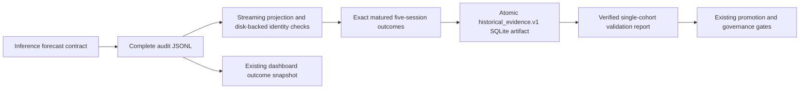

# Historical validation evidence integrity

## Confirmed defects and limits of the audit

The previous pipeline mixed audit activity, display data and model evaluation:

1. `GET /api/user-watchlist` appends one audit event per processed position on every request. Repeated portfolio loads therefore dominate a latest-5,000-event window. Its source expression could select the AI portfolio enhancement mode while probability/version came exclusively from the optional deterministic portfolio result. An AI narrative never generated those missing model values. The quote-only portfolio signal also cannot satisfy every model's serving feature contract; deterministic inference can correctly return no prediction. Which individual rollout/feature condition applied to each production event cannot be established from aggregate diagnostics alone.
2. `day12_materialize_outcomes.py` evaluated up to 5,000 events, then selected recent unique display rows by day, symbol, source, action, version and outcome. `page6_historical_validation_report.py` consumed those `rows_5d` display rows. Many available returns could collapse to a handful of observations; returns without a recorded forecast were still counted. Increasing the display limit did not establish independent prediction evidence.
3. Historical `_probability` accepted numeric strings, divided values above one by 100 and clipped negatives. This could score invalid probabilities. The new regression fails against the original module (`-0.1` produces a Brier score of 1.0) and passes after the repair.
4. The original outcome projection used snapshot quote staleness but did not consistently recognize `quote_is_stale`; metric code also used truthiness. A string such as `"false"` could be interpreted as true. These are confirmed parsing risks, **not proof** that the owner's reported stale rows were false positives. The original per-row quote/source timestamps were not available in this workspace. No stale observation has been relabeled fresh.
5. Scanner recommendation projection copied version/probability but had no durable originating forecast contract. Portfolio personalization and AI enhancement could describe a different action from the model's scored forecast.

The owner's production evidence is the input to this investigation, not a new live-data audit. No production decision log, workflow or model was modified or rerun. Public examples and measurements below are synthetic.

## Provenance and identity

`model_forecast.v1` is created at actual deterministic model inference, before portfolio rules, suitability or narrative changes. It contains the served probability (including the existing model's rounding/calibration), raw probability, recommendation, model version, artifact hash, calibration settings, feature-input hash, forecast horizon, outcome contract, decision timestamp and decision-time quote provenance. No probability is generated from confidence, advice, sentiment or subsequent returns.

The prediction ID hashes the immutable model/input/output contract. It excludes request/user identifiers, receipt time and portfolio action. Repeated inference over identical features and the same source quote shares one ID; changes to real inputs can produce distinct same-symbol/same-day IDs. The first observed decision timestamp is retained. This establishes distinct prediction contracts, **not statistical independence** of correlated financial observations.

The underlying forecast travels through Quick Ask, portfolio and scanner projections. Shadow forecasts remain shadow-only. A missing source timestamp yields no verifiable ID. Legacy records are retained in the audit log but excluded from authoritative validation if they lack the new verifiable contract/identity. There is no historical probability backfill.

`decision_event.v2` adds event categories. Watchlist events remain portfolio advice, with AI narrative mode recorded separately and any genuine underlying forecast in its own envelope. Quote-only model inputs are explicitly ineligible. Audit logging is retained on every page load. Logging or forecast serialization failure cannot change user-facing recommendations.

Existing proven legacy five-day models use the repository's upward-close-return label contract. Other model versions require explicit matching outcome-contract metadata; a horizon alone does not establish label semantics. No active artifact is edited by this repair.

## Dedicated evidence artifact

The weekly sequence is now:



`historical_validation_evidence.v1.sqlite` lives in the existing runtime directory. It is independent of `decision_outcomes_snapshot.json`; dashboard row selection, limits and response contracts remain unchanged.

The builder captures an open file's initial byte length and scans that complete append-only prefix once. Appends after that boundary belong to the next run. It decodes at most one record at a time, retains only compact candidates in SQLite, and performs duplicate/conflict selection on disk. The manifest includes source-prefix SHA-256, physical lines/events, captured/scanned bytes, source/endpoint/category counts, exclusion reasons, eligible/independent/mature/live/shadow counts, provider diagnostics, row count and checksums. Exclusion reasons overlap and must not be summed as independent events.

An explicit test-only scan limit is marked truncated/incomplete. Malformed or over-2-MiB records are counted, drained in bounded chunks and mark coverage incomplete. Missing input, concurrent non-append mutation detected during the scan, SQL errors and artifact failures raise errors and preserve the previous canonical artifact. There is no arbitrary production event-count cap and no silent partial dataset presented as complete. Completeness means coverage of the captured source prefix; it cannot establish coverage of events never logged, deleted logs or missing historical forecasts.

Exact repeats count once. Conflicting reuse of an ID, including a malformed copy of an otherwise valid ID, excludes that ID entirely. Invalid/missing model metadata, probabilities, source timestamps, horizons, identities or quote-only inputs have explicit exclusion counts. Shadow outcomes remain identifiable in the artifact but are excluded from the live promotion sample.

The report verifies the manifest checksum, canonical row checksum, row count and selection columns before reading rows. It streams metrics from SQLite. A model cohort includes version, artifact hash, calibration configuration and outcome contract. Automatic selection requires exactly one live cohort. `--model-version` can select a version only if it resolves to one cohort; ambiguous versions remain blocked. Baselines must identify the same cohort and outcome contract. No mixed-model aggregate is used for promotion.

## Outcome and quality semantics

The versioned outcome contract is XNYS close-to-close: the first session close strictly after the decision, followed by five trading sessions. Before/during-session decisions use that day's eventual close; decisions at/after close use the next session's close. All six session prices must exist, be finite and positive, and the final session must have closed by the dataset's as-of instant. Missing dates cannot shift the horizon. Weekends, holidays and early closes use the existing exchange calendar. Forecasts with other label/horizon contracts are excluded.

This is the repository's close-return target, not a claim of an executable intraday fill. Prices are split-adjusted close prices: Massive uses adjusted aggregates, and the visible yfinance fallback uses `Close` with `auto_adjust=False`. The manifest no longer falsely labels these mixed provider conventions as dividend-adjusted total returns. Each outcome records provider, retrieval time, requested range, exact endpoint sessions and price-path checksum. Numeric provider timestamps accept seconds, milliseconds, microseconds or nanoseconds without moving a session to 1970.

The new history cache uses bounded month ranges, at most 128 entries/20,000 price points; per-response admitted history is capped at 128 bars. Provider-symbol diagnostics are bounded to 256 entries. Identical symbol/month requests reuse history. Provider/network-library allocations before a response is returned are outside that retained-cache bound. Provider fallback failures are counted without publishing raw error strings.

Decision-time stale flags, session/source timestamps, delayed-data labels and source mode are preserved separately from outcome-history validity. A literal boolean true or explicit stale flag remains stale; unknown freshness is not assumed fresh. Stale rows remain in the scored dataset and in the stale-rate denominator, so removing them cannot improve the gate. Unknown freshness and missing/invalid mature history add integrity blockers. Mature-history exclusions cannot silently leave only surviving symbols eligible for promotion. Dataset `includes_delisted=false` explicitly avoids claiming survivorship-complete coverage.

Brier and ECE use the recorded upward probability against the same forecast's upward-return label. Invalid probabilities (including booleans, strings, infinities, NaNs and fractions outside `[0,1]`) are excluded, never converted/clipped/defaulted. Directional gross/net returns use the model action, not personalized actions; HOLD has zero directional exposure. Existing friction, baseline regression, adverse-excursion, churn, stale/fallback, sample-size and review gates remain. No probability-bearing sample yields `calibration_status=insufficient_evidence` and `brier_score=null`.

## Status and compatibility policy

The existing weekly CLI exit, HTTP and GitHub pass/fail policy is preserved:

| Condition | execution_status | validation_status | promotion_ready | Weekly exit / HTTP |
| --- | --- | --- | --- | --- |
| Complete report, all gates pass | success | passed | true | 0 / 200 |
| Complete report, too few valid forecasts | success | insufficient_evidence | false | 1 / 500 |
| Complete report, quality/governance gates block | success | blocked | false | 1 / 500 |
| Failed/timed-out stage, corrupt/missing/stale artifact | failed | unavailable | false | nonzero / error |

The historical report writer itself exits zero after successfully producing a verified report, including blocked diagnostics. The weekly wrapper retains its prior promotion-sensitive exit policy. Additive status fields pass through API receipts and the workflow's bounded allowlist. Existing `success`, `status`, `failed_stage`, authentication, deadlines, shared execution lock, durable idempotency, descendant cleanup and outer supervisor are preserved. A nonzero child exit cannot be overwritten by an apparently passing report.

Changing GitHub to an execution-only success policy remains a separate product decision. Even if approved later, it must never activate a model or reinterpret `promotion_ready=false` as approval.

The report remains `historical_validation.v1` with additive fields. Its input CLI intentionally changes from dashboard `--outcomes`/display-manifest options to `--evidence` and optional `--model-version`; old input flags fail clearly. Callers must materialize and verify the new artifact first. The weekly wrapper performs that migration automatically after deployment. The old dashboard snapshot remains available to its existing consumers.

Daily calibration keeps PR #664's bounded scan, atomic output, provider caching and deadlines. New v2 events use their verified originating forecast, exclude shadow/quote-only records, and deduplicate IDs within the selected window; malformed conflicting copies invalidate the earlier selected ID. Legacy daily calibration diagnostics retain their existing historical-window behavior. That legacy calibration report does not substitute for the new authoritative validation dataset or override its gates.

## Files changed

| File | Behavior |
| --- | --- |
| `moneybot/services/prediction_evidence.py` | Forecast schema, strict probability/timestamp helpers, stable identity and event categories. |
| `moneybot/services/deterministic_advisor.py` | Originating forecast at inference; portfolio/shadow preservation; proven label-contract selection; telemetry failure isolation. |
| `moneybot/services/market_data.py` | Preserve the forecast through momentum and breakout recommendation projections. |
| `moneybot/api.py` | Log originating forecasts; separate watchlist narrative mode; pass shadow symbol. |
| `moneybot/services/decision_log.py` | Add event schema/category and separate forecast envelope without removing audit events. |
| `moneybot/services/decision_snapshot.py` | Strict probability values and richer quote provenance; retain v1 snapshot compatibility. |
| `moneybot/services/historical_evidence.py` | Full-prefix streaming, disk-backed identity/conflict selection, bounded exact-session outcomes, atomic artifact and verification. |
| `moneybot/services/historical_validation.py` | Strict probability scoring and streaming metrics with disk-backed churn state. |
| `moneybot/services/outcome_history_provider.py` | Correct mixed epoch units, bounded provider map, numeric failure diagnostics. |
| `moneybot/services/runtime_paths.py` | Dedicated versioned evidence path on the existing runtime disk. |
| `moneybot/services/ops_execution.py` | Carry execution/validation/promotion fields through existing receipts; lock/runner behavior unchanged. |
| `scripts/materialize_validation_evidence.py` | Offline-capable evidence stage entry point. |
| `scripts/page6_historical_validation_report.py` | Verified evidence-only reports, cohort/baseline/quality integrity gates. |
| `scripts/day13_calibration_report.py` | Strict probability range, v2-origin projection and bounded-window prediction deduplication. |
| `scripts/run_weekly_model_refresh.py` | Evidence stage, fresh artifact requirements, distinct execution/validation statuses; retain existing exit policy. |
| `.github/workflows/moneybot-weekly-refresh.yml` | Print additive status fields; schedule, concurrency, request, retries and pass/fail unchanged. |
| `scripts/benchmark_historical_evidence.py` | Deterministic 5k/20k/50k offline fixtures and full-path resource measurements. |
| `tests/test_historical_evidence.py` | Provenance, identity, invalid inputs, sparse coverage, session maturity, quality, manifest and gate regressions. |
| `tests/test_deterministic_advisor.py` | Stable real inference IDs, shadow/portfolio propagation, quote-only exclusion and telemetry isolation. |
| `tests/test_dashboard_api.py` | Watchlist provenance regression and symbol-aware shadow fixture. |
| `tests/test_historical_validation.py` | Original-code invalid probability regression. |
| `tests/test_ops_reliability.py` | Evidence-stage fixtures, nonzero/stale/corrupt/missing report failures, blocked receipt replay; keep all real-process tests. |
| `tests/test_outcome_history_provider.py` | Epoch units and bounded provider diagnostic map. |
| `tests/test_run_weekly_model_refresh_script.py` | Assert new ordered stage and input-log forwarding. |
| `docs/historical_validation_evidence_integrity.md` | Audit, evidence rules, measurements, compatibility and rollout. |

## Verification and resource evidence

The final test results and benchmark table are appended below. Tests use synthetic logs and mocked providers, including actual process trees for the PR #664 safety checks. No production credentials or workflows are needed.

The sparse fixture places 12 genuine predictions before repeated watchlist traffic. The mixed fixture has 12 genuine live forecasts, 12 repeats, 12 invalid probabilities, 12 missing model versions, 12 shadow forecasts, and otherwise watchlist advice, each with 8 KiB of unused snapshot text. Its 50,000-event run scans all 50,000, finds 36 eligible forecast events including repeats, excludes 12 duplicates, materializes 24 independent mature forecasts (12 live/12 shadow), evaluates 12 live rows, makes one history request, and reports Brier 0.04 with insufficient evidence and unapproved licensing/privacy. Missing-model/probability counts include non-model observations; exclusion categories overlap. No stale fixture rows are present in this benchmark; dedicated tests preserve a 1/3 stale rate.

A 40-forecast same-symbol/day regression produces one old-style dashboard display row but 40 dedicated validation rows. Real duplicate prediction IDs still count once. No thresholds are reduced.

### Measured results

399 tests passed in 31.49 seconds across 19 relevant test modules. The final compact-projection optimization was additionally checked with 108 passing calibration/evidence/reliability tests. The final execution-status correction additionally passed 151 reliability/API tests. Changed Python AST checks and `git diff --check` passed. No repository lint, formatter or type-check configuration was found.

The required tests (`test_outcome_tracking`, `test_historical_validation_api`, `test_ops_reliability`, `test_run_daily_ops_script`, `test_dashboard_api`) were included, together with evidence, metrics, snapshots/training/promotion safeguards, logging, horizon, deterministic model/advisor, calibration/recalibration, weekly commands, runtime paths, market service/providers and outcome-provider tests. No process safety test was removed.

Linux/Python 3.11, one fresh benchmark process per case, BLAS threads=1, synthetic 8-KiB snapshots, mocked prices; measured phase includes artifact build, checksum verification and report metrics:

| Events | Fixture | Peak RSS MiB | Seconds | Live evaluated rows | History requests |
| ---: | --- | ---: | ---: | ---: | ---: |
| 5,000 | none | 60.11 | 0.137 | 0 | 0 |
| 5,000 | sparse | 60.99 | 0.146 | 12 | 1 |
| 5,000 | mixed | 61.11 | 0.143 | 12 | 1 |
| 20,000 | none | 60.11 | 0.557 | 0 | 0 |
| 20,000 | sparse | 61.11 | 0.575 | 12 | 1 |
| 20,000 | mixed | 61.11 | 0.546 | 12 | 1 |
| 50,000 | none | 60.11 | 1.409 | 0 | 0 |
| 50,000 | sparse | 61.11 | 1.425 | 12 | 1 |
| 50,000 | mixed | 61.11 | 1.565 | 12 | 1 |

The 50,000-distinct-forecast stress case evaluated all 50,000 rows at 64.49 MiB RSS in 11.704 seconds, with one mocked history request and a 179,482,624-byte SQLite file. It remained blocked by unapproved governance gates. The 50,000 mixed fixture also completed under a 512-MiB virtual-address-space ceiling at 61.11 MiB RSS in 1.369 seconds. The retained 50,000-event/12-mature-row calibration benchmark completed at 121.91 MiB RSS in 4.204 seconds, compared with the prior repair's recorded 119.45 MiB; it retains bounded memory and the original substantial reduction from the 1,325.12-MiB legacy-reader benchmark. These measurements are per process, not aggregate production-service maxima.

Reproduce offline:

```bash
python scripts/benchmark_historical_evidence.py --events 5000 --case none
python scripts/benchmark_historical_evidence.py --events 20000 --case sparse
python scripts/benchmark_historical_evidence.py --events 50000 --case mixed
python scripts/benchmark_historical_evidence.py --events 50000 --case all
python scripts/benchmark_calibration_memory.py --events 50000 --mature-rows 12
```

## Rollout and rollback (requires separate authorization)

1. Review and merge the new PR only after approval. Review the separate evidence contract, retained weekly exit policy, CLI migration and disk needs. No migration changes the active model or governance settings.
2. Deploy through the normal approved path. Before running production work, verify the active artifact hash/version is unchanged, the persistent runtime directory is mounted, and no other ops bundle is active.
3. Preserve the append-only audit log and last good artifacts. Observe normal requests to confirm v2 forecast envelopes, timestamps and quote flags. Do not generate artificial predictions or backfill historical probabilities. Legacy-only logs may legitimately produce zero eligible observations until authentic new forecasts mature.
4. After explicit approval, run one Daily Ops job with a fresh idempotency key; then one Weekly Refresh job with a different intentional key. Inspect shared-lock/idempotency behavior, stage durations, service-wide RSS, disk usage, fresh evidence/report timestamps, checksum verification, counts/exclusions, actual cohort and governance blockers. A retry with the same key must replay its receipt. Do not automatically rerun a failure.
5. Expect red weekly status if evidence or approvals are insufficient. Reconcile stale quote flags with original provider event timestamps, session state and delay entitlement. Resolve history gaps/provider failures without relabeling bad data.
6. Licensing approval needs documented provider/exchange entitlements for storage, derived data, historical reuse and redistribution, including fallback and delayed feeds. Privacy approval needs review of decision logs/profile linkage, access controls, retention/deletion, aggregate diagnostics and data minimization. Authorized reviewers must record actual approvals before changing either existing flag.
7. Roll back by reverting this PR/deploying the prior approved commit. Preserve the new SQLite artifact for diagnosis; old code ignores it. Restore a known compatible historical report only through an approved operational procedure; do not treat a stale artifact as refreshed. Existing audit payload/snapshot fields remain readable by old code. Do not change the active model, overwrite source logs or release an uncertain process-cleanup lock. Remove abandoned temporary artifacts only after confirming no running job owns them.

Remaining limits: full scans require I/O proportional to retained log size and SQLite disk proportional to compact predictions. Very large logs/symbol universes can hit the unchanged deadlines; failures remain explicit. A killed builder can leave temporary files. The append-only source assumption does not protect against arbitrary external same-size rewrites during concurrent appends. Statistical dependence, selection bias of BUY-only scanners, market-calendar coverage, corporate-action revisions and incomplete delisted-symbol coverage still require model review; this implementation does not certify them away. Per-process synthetic memory results do not establish total Render service memory safety with Gunicorn, providers and other jobs present. No automatic promotion or activation is introduced.
